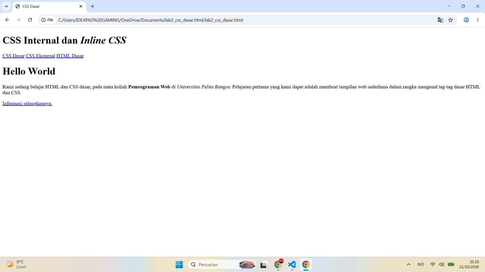

# CSS Dasar

## Identitas Mahasiswa

**Nama:** Tegar Aldiano Kurniawan  
**NIM:** 312510058  
**Kelas:** I253B  
**Mata Kuliah:** Pemrograman Web

## Deskripsi

Project ini merupakan tugas **CSS Dasar** yang dibuat menggunakan Visual Studio Code.

Project ini berisi latihan membuat dokumen HTML, mendeklarasikan CSS Internal, menambahkan Inline CSS, membuat CSS Eksternal, dan menggunakan CSS Selector.

## Project

Proyek ini dibuat untuk mempelajari dasar-dasar styling pada halaman web menggunakan Cascading Style Sheets (CSS). Dalam project ini, setiap materi dipelajari secara bertahap mulai dari pembuatan dokumen HTML sederhana hingga penerapan gaya visual yang lebih rapi dan terstruktur dengan CSS.

Tujuan dari project ini adalah:

- memahami struktur dasar dokumen HTML
- menerapkan CSS Internal pada halaman web
- menambahkan style secara langsung dengan Inline CSS
- memisahkan style ke file CSS eksternal
- menggunakan selector CSS untuk mengatur elemen tertentu

## Materi yang Dipelajari

### 1. Membuat Dokumen HTML

Pada materi ini dipelajari cara membuat dokumen HTML sebagai dasar untuk membuat sebuah halaman web.



### 2. Mendeklarasikan CSS Internal

CSS Internal digunakan untuk memberikan style pada halaman HTML dengan menuliskan kode CSS di dalam tag `<style>`.


### 3. Menambahkan Inline CSS

Inline CSS digunakan untuk memberikan style secara langsung pada elemen HTML menggunakan atribut `style`.


### 4. Membuat CSS Eksternal

CSS Eksternal digunakan untuk membuat kode CSS pada file terpisah dari HTML. Pada materi ini dibuat file `style_eksternal.css`.


### 5. Menambahkan CSS Selector

CSS Selector digunakan untuk memilih elemen HTML yang akan diberikan style. Pada materi ini digunakan selector seperti `nav`, `nav a`, `.active`, dan `:hover`.


## File Project

```text
Lab3web/
│
├── lab2_css_dasar.html
├── style_eksternal.css
├── images/
│   ├── 01-dokumenhtml.png
│   ├── 02-mendeklariskan css internal.png
│   ├── 03-Menambahkan Inline CSS.png
│   ├── 04-Membuat CSS Eksternal.png
│   └── 05-menambahkan css selector.png
│
├── readme.md
└── README.md
```

## Cara Menjalankan

1. Buka file `lab2_css_dasar.html` menggunakan browser.
2. Pastikan file `style_eksternal.css` tersedia di folder yang sama.
3. Jika ingin melihat semua latihan, buka halaman HTML yang telah dibuat agar style CSS diterapkan.

## Kesimpulan

Project ini membantu memahami dasar-dasar penggunaan CSS untuk menghias elemen HTML, mulai dari styling sederhana hingga pendekatan yang lebih terorganisir melalui file CSS eksternal dan selector.
